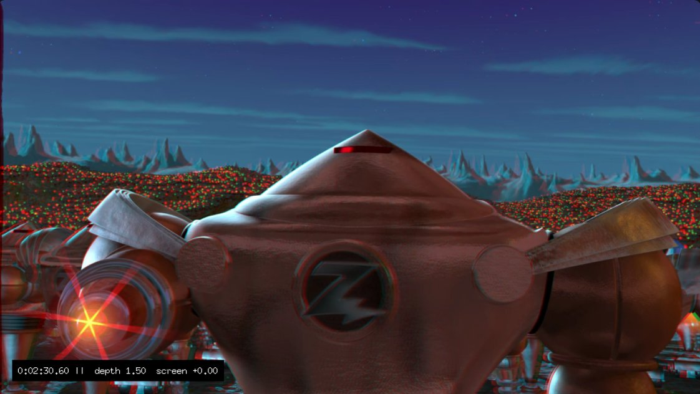
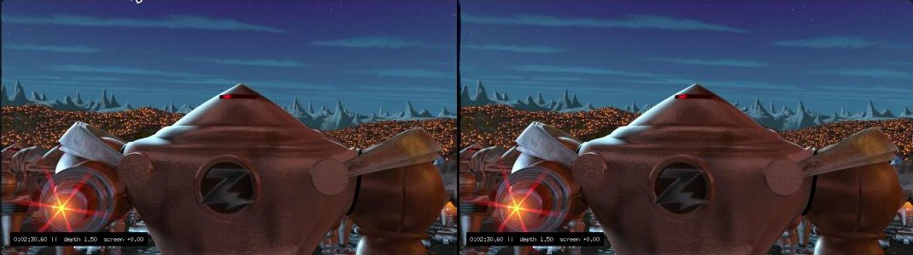
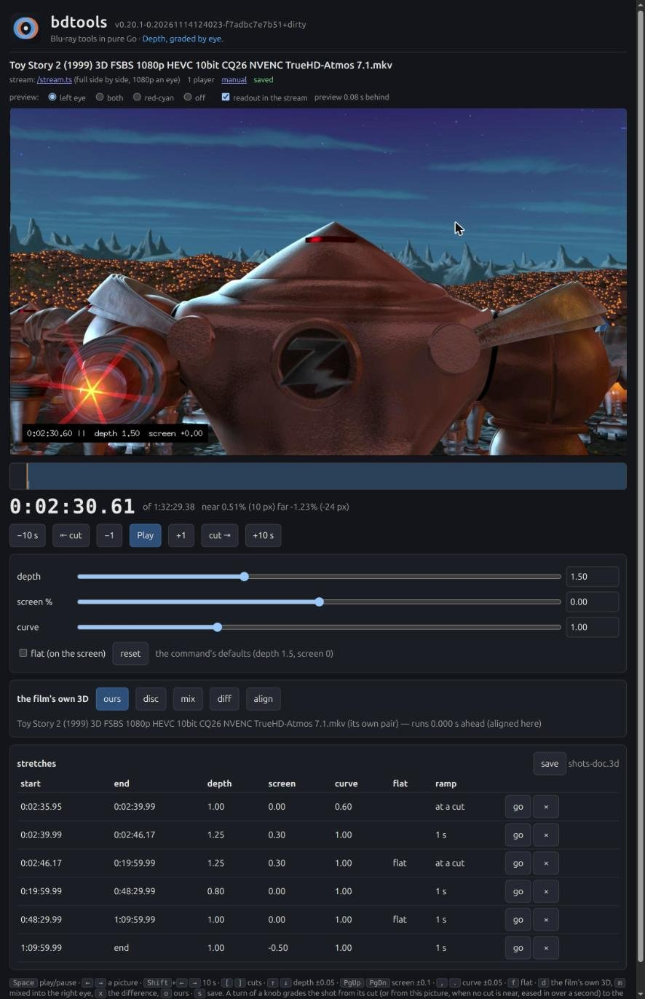
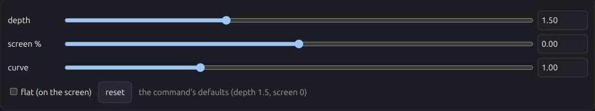
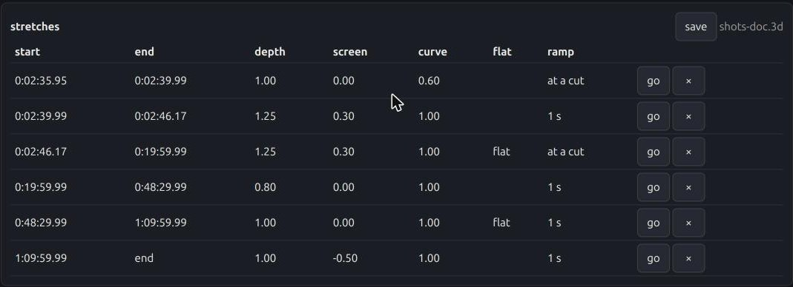
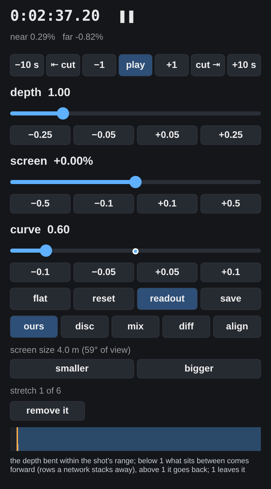
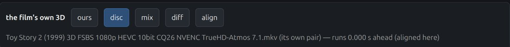
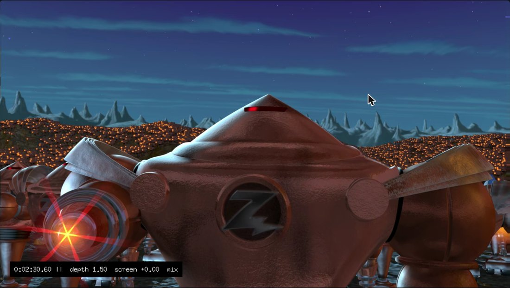
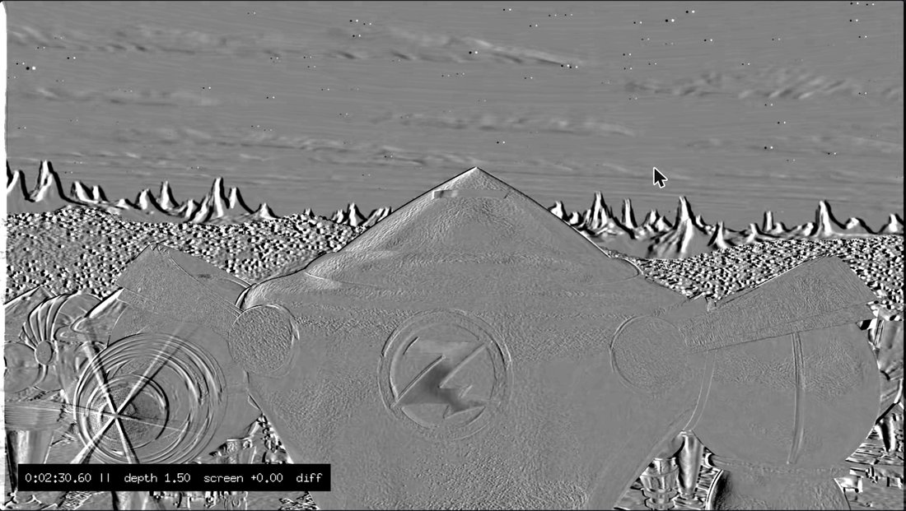

# Grading a film's 3D by eye

This guide explains how to grade a 2D-to-3D conversion by eye with
`--3d-grade`: how to start it, how to watch it, what each control does
on the page and in the headset, and how what you set ends up in the
finished film. It assumes you have run `--to-3d` at least once and that
you have some way of seeing 3D, whether a television, a projector or a
headset. If you want to know what the conversion does with the depth and
how well it does it, that is in [2d-to-3d.md](2d-to-3d.md). The flags
themselves are listed in the [README](../cmd/bdtools/README.md#2d-to-3d).

## Why grade at all

`--to-3d` estimates the depth of every picture and makes a left and a
right eye from it. The default depth was measured against real 3D
Blu-rays, and for most of a film it is right. But no automatic depth gets
every shot right. These are the cases we keep running into:

- Sometimes the depth network reads a shot wrongly. The classic case is
  rows of people or things seen from below. The network stacks them away
  behind each other, when in the film they stand side by side. The curve
  knob is for this.
- A shot comes too far out of the screen, or sits too deep behind it.
  The depth and screen knobs fix that.
- Some pictures should have no depth at all: a title card, a screen
  within the picture, a map, a 2D insert. The flat knob puts them on the
  screen. (The end credits are found and flattened on their own.)
- Titles and logos laid over the picture should stand in front of the
  scene. The conversion lifts them on its own in the film's first 5
  minutes. The titles knob turns that on or off for a stretch, for
  credits later in the film or for a sign it took for a title.
- A whole film may want a little more or less depth than the default.

Grading means setting the knobs for stretches of the film and saving
them to a shots file, which the conversion proper reads. While you
grade, nothing is written to a video file. Instead, the film is
converted live as it plays, as fast as it plays, and you watch the
result on a 3D screen or in a headset while you turn the knobs.

## What you need

- A machine with an NVIDIA GPU. The depth network runs on it faster than
  the film plays, and NVENC encodes the live stream. Without one there is
  no live stream.
- The film, as an MKV, MP4 or MOV, or the disc image itself.
- Something that shows 3D. A 3D television or projector works if its
  player can take a live stream (Kodi and VLC can). A Meta Quest works
  through its browser. If all you have is a laptop, red-cyan paper
  glasses are enough for a rough check.
- Optionally, the film's own 3D release, if there is one, to compare
  against. More on that in
  [Comparing with the film's own 3D](#comparing-with-the-films-own-3d).

## Starting the server

Let's start with the command:

```sh
bdtools --input "Film (2020).mkv" --output "Film (2020).3d" --to-3d --3d-grade :8420
```

It prints where everything is:

```
bdtools: --3d-grade: the controls at http://192.168.1.87:8420/, the 3D stream at http://192.168.1.87:8420/stream.ts (full side by side); the grade goes to Film (2020).3d
bdtools: --3d-grade: for a headset, https://192.168.1.87:8421/ (its certificate is this machine's own: accept it once), then Enter VR
```

So what did we ask for? `--to-3d` says this is a 2D-to-3D conversion.
`--3d-grade :8420` says: don't convert to a file, serve the film live on
port 8420 instead. And `--output` is not a video file here. It is the
shots file your grade is written to, at every change. Give it a name you
will remember, because you will pass it to the conversion later.

A few things you may want to add:

- `--3d-shots FILE` starts from a grade you made earlier, or wrote by
  hand. It can be the same file as `--output`.
- `--start 1:02:00` opens the film at that time instead of the
  beginning.
- Any other `--to-3d` flag: `--3d-depth`, `--3d-screen`, `--3d-curve`, `--3d-text`,
  `--depth-model`, `--3d-refine`, `--3d-fill`, `--3d-screen-size`. These
  become what the page calls "the command's defaults", and every stretch
  you grade is set relative to them. This matters later: the conversion
  proper must be run with the same flags, or your stretches land on
  different defaults. See [The conversion](#the-conversion).

## Watching the stream

The server serves the converted film as a live stream at
`http://HOST:8420/stream.ts`. It is full side by side, 1080p per eye,
H.264 in a transport stream, which is something most players can play
live. You have a few ways to watch it.

**Kodi** on a box at the screen. Make a `.strm` file holding the
address, and name it with the 3D tag your library uses, the same way
the conversions are named, for example `Film (2020) 3D FSBS.strm`. Kodi
then picks the side-by-side mode and the television shows it in 3D. One
thing to know: Kodi buffers a few seconds by default, and that buffer is
the delay between a turn of a knob and the screen. Its cache settings
bring it under a second.

**VLC**, on a computer, a phone or a television. Open the address as a
network stream and set the 3D mode to side by side.

**A headset's browser.** This needs no player at all. See
[In the headset](#in-the-headset).

**The page's own preview.** The control page shows the stream itself,
under the controls, as the left eye alone, as both eyes side by side, or
as a red-cyan anaglyph for paper glasses. It runs a tenth of a second
behind the server, so it is the quickest way to check that a turn did
what you meant.





There is also a readout drawn into the bottom of both eyes of the
stream, at the screen's depth. It shows the time, whether the film is
playing, the knobs, the current stretch and the view. It is there so
that the screen tells you the state while your hands are on the page or
the controllers. If you want a clean picture, the "readout in the
stream" box turns it off.

## The page

Open `http://HOST:8420/` in any browser, on a laptop or a phone. Every
control explains itself when you hover over it, but here is the tour,
from the top.



**Transport.** Play or pause, a picture back or forward, ten seconds
either way, and a jump to the cut before or after. A paused picture keeps
its depth, so if you turn a knob while paused, the change shows at once
(or rather, after the player's buffer).

**The bar.** This is the whole film. The stretches you have graded are
blue bands, the current one lighter; the cuts seen so far are ticks along
the bottom; the orange line is where you are. Click anywhere on it to
seek. Under the bar are the time, the film's length, and where this
picture's nearest and farthest points land, as a percentage of the width
and in pixels. Keep an eye on the near figure: anything much past 1% in
front of the screen strains the eyes.

Making a picture's 3D, or tracking an object, can take longer than the
picture lasts on screen. A 4K film with everything on is one case. The
grader then plays in slow motion and skips nothing. When that happens, a
warning in orange next to the figures says how many pictures a second
go out and what the film's own rate is, for example "slow: 18.2 of 24
pictures a second". The same warning is on the VR panel and in the
stream's readout, so you always know when you are not seeing the film
at its real speed.

**The knobs.** There are three, each a slider and a number, plus a
checkbox and a menu. You can turn them from the keyboard too.



- **depth** scales the depth. 1 is what the 3D discs have, and the
  slider runs from 0.2 to 4. Turn it up for a shot that looks flat, down
  for one that strains.
- **screen %** moves the whole depth nearer or farther, in percent of
  the picture's width. Positive is nearer. Use it to bring a shot out of
  the screen or set it back without changing how deep it is.
- **curve** bends the depth within the shot's range. At 1 the depth is
  as the network gives it. Below 1, whatever sits between the shot's
  farthest and nearest points comes forward; above 1 it goes back. This
  is the knob for rows the network stacks away behind each other when
  the film has them side by side, such as a crowd or a line of things
  seen from below. Somewhere between 0.5 and 0.7 usually brings them to
  where a disc would have them. Don't make it a default, though. On
  ordinary shots it measures worse than 1.
- **flat** removes the depth and puts the picture on the screen. Use it
  for title cards, screens within the picture, maps and 2D inserts.
- **titles** says where the text laid over the picture, the titles,
  credits and studio logos, is lifted in front of the scene. auto lifts
  it in the film's first 5 minutes, on lifts it anywhere, and off leaves
  it at the depth of what it is written over. Set on for a stretch of
  credits over a scene later in the film, and off where a sign or a
  screen in the film was taken for a title. The detector looks two
  seconds ahead of the picture you see, so a line of text rises as it
  appears. When you change the knob on a paused picture, the lines
  the detector is sure of go up or down at once.

**reset** puts the current stretch back to the command's defaults. The
text beside it tells you which stretch the knobs are grading, or that
this picture is at the defaults.

**The film's own 3D** appears only when there is a reference. The
buttons are ours, disc, mix, diff and align, and they are explained in
[Comparing with the film's own 3D](#comparing-with-the-films-own-3d).

**Stretches.** The table lists everything you have graded: where each
stretch starts and ends, its knobs, whether it is flat, and how it comes
in (at a cut, or eased in over some seconds). `go` seeks to a stretch's
start. `×` removes it, and the stretch before then runs on over what it
covered, or the defaults do if there is none. The `save` button writes
the file, but you will rarely need it. The file is written at every
change, and "saved" or "unsaved" at the top of the page tells you whether
that worked.



### Keys

| Key | What it does |
|---|---|
| Space | play or pause |
| ← → | a picture back or forward |
| Shift+← Shift+→ | ten seconds back or forward |
| [ ] | the cut before or after |
| ↑ ↓ | depth up or down by 0.05 |
| PgUp PgDn | screen up or down by 0.1 |
| , . | curve down or up by 0.05 |
| f | flat on or off |
| t | titles: auto, on, off, and round again |
| d, m, x, o | the disc's 3D, the mix, the difference, ours |
| s | save |
| p | paint an object, or stop painting |
| Enter | track the object painted |
| Esc | drop the hints painted |

## How a turn becomes a stretch

You don't mark out stretches first and then grade them. You just turn a
knob, and a stretch is made for it. Where it starts depends on where you
are:

- If there is a cut within the two seconds before the current picture,
  the stretch starts at that cut. The idea is that you react to a shot a
  moment after it starts, so the stretch is snapped back to where the
  shot began, and the change happens at the cut, where no eye sees it.
- Otherwise the stretch starts at the current picture, and the change
  eases in over one second (`ramp=1` in the file). An eased change is
  invisible where a jump would show.

The stretch runs until the next stretch starts, or to the end of the
film. Turning a knob inside an existing stretch changes that stretch.

So the pattern is simple: play, notice a shot that is off, pause, turn
until it looks right, play on. If only that one shot needed grading,
play to its end and press reset there (or turn the knob back). That
starts a new stretch at the next cut, with the defaults.

A word about the cuts. They are found while the film plays, by comparing
each picture's thumbnail with the one before, so the bar only shows cuts
for what has actually been played. Skipping ten seconds skips the cuts
in between, and a dissolve is never a cut. And if you want a whole film
a little deeper or shallower, don't make one huge stretch. Set
`--3d-depth` and `--3d-screen` on the command instead, and grade only the
shots that differ.

## Objects

Some shots can't be put right with the knobs, because the knobs move the
whole picture. The Disney castle at the start of Toy Story 2 is one. The
"Walt Disney" wordmark gets the depth of the lake below the castle, so
the depth and the screen move the letters and the lake together. An
object is a part of the picture whose depth you move on its own. You
paint it on one picture, the page follows it through its shot, and its
push moves it nearer or farther than the scene around it.

To paint an object:

1. Pause on a picture where the object is plain to see.
2. Press paint, or `p`. From now on the preview takes hints instead of
   clicks.
3. Drag a box around the object on the preview. A moment later the
   object shows in red in the stream and in the preview. The first
   time, the object finder is downloaded first, which takes a while.
4. If the red misses part of the object, click on that part. That adds a
   point on the object, drawn in green. If the red takes in something
   that isn't the object, Shift-click on it. That adds a point off the
   object, drawn in red. Every hint makes the mask again.
5. Press track, or `Enter`. The page follows the object back to the cut
   before and on to the cut after, at most 10 seconds back and 30 seconds
   on. It stops early once the object has been gone for 2 seconds, so a
   logo that fades out does not hold it up. The stream shows each
   picture with its mask as it goes, at about the film's own speed, and
   the objects panel says how many pictures a second it tracks. On the
   Toy Story 2 castle it followed the wordmark through 163 pictures in
   about 13 seconds, which includes going back to the cut before.
6. Set the object's push in the objects table. A push is a percent of
   the width, like the screen knob, and more brings the object nearer.

`Esc`, or cancel, drops the hints without making an object.

The objects table lists each object with the first and the last picture
it was found on, its push and how many pictures it has a mask on. `go`
seeks to its start. `show` draws its mask in red over the picture while
you play, so you can check that it was followed well, and `hide` stops
that. `paint` paints it again on the paused picture, and tracking from
there replaces its masks where it goes. `×` removes the object. The bar
under the preview shows each object as a red strip.

The object finder is SAM 2.1's tiny model, from Meta, under the Apache
2.0 license. It is downloaded once, 156 MB, into the same cache as the
depth network. It finds an object from a box better than from points
alone, so start with a box.

## A session, step by step

1. Start the server. Open the page on a laptop or phone, and start the
   player at the screen, or put the headset on and press Enter VR.
2. Play from the start. Watch the picture and the near and far figures.
   Most shots will be fine. Let them go by.
3. When a shot is off, pause. Step back a picture or two with ← until you
   see what caught your eye, then turn the knob. Check a second picture
   of the same shot (→, or play for a moment).
4. Play on. You don't have to do anything at the end of the shot. The
   stretch ends where the next one begins, or at the end of the film, and
   the following shots get whatever is set. If they should be back at the
   defaults, press reset there.
5. At the end, check that the top of the page says "saved", and stop the
   server with Ctrl-C.
6. Run the conversion with the file, as described in
   [The conversion](#the-conversion). You can come back to the grade any
   time by starting the server again with `--3d-shots FILE`.

## In the headset

A headset's browser shows the same page, but over HTTPS and on the next
port: `https://HOST:8421/`. The certificate is one the machine made for
itself, so the browser will ask you about it once. Accept it. WebXR only
works on a secure page, which is why the plain HTTP page has no Enter VR
button.

Press Enter VR and the picture is on a four-metre screen in front of
you, each eye seeing its own, with the page's controls on a panel to the
right. Point the right controller at the panel: its ray puts a cursor
there, and the trigger presses whatever is under it. Hold the trigger on
a slider to drag it. The foot of the panel tells you what the cursor is
over and when you would use it. From the top, the panel has the time and
the near and far figures, the transport, the three knobs as sliders with
step buttons, the titles buttons auto, on and off, flat, reset, the readout and save, the views when there is
a reference, the screen's size, the current stretch with a button to
remove it, the objects, and the timeline, which you press to seek.



You can also work the controllers without looking at the panel:

| Controller | What it does |
|---|---|
| right trigger | presses the panel; off the panel, play or pause |
| right stick up and down | depth up or down by 0.05 |
| right stick left and right | screen up or down by 0.1 |
| right grip | flat on or off |
| A, B | a picture forward, back |
| left trigger | ours, the disc's 3D, the mix, and round again |
| left stick left and right | the cut before, after |
| X, Y | ten seconds back, forward |
| both grips, held for a second | leave VR |

You can paint an object in VR too. Pause, and press paint on the panel.
Then aim at the screen. A white cross shows where the ray meets it.
Click the trigger to put a point on the object, or hold it and drag to
draw a box around the object. Press the grip on the screen to put a
point off the object. The mask shows in red on the screen a moment
later, and track on the panel follows the object through its shot. Under
the painting buttons the panel has the last three objects, each with
buttons to push it nearer or farther and to show or hide its mask.
While you paint, the grip does not turn flat on and off, and the
trigger presses the panel only when you aim at the panel.
The cross and the hints show only when the page draws the screen itself,
which it does unless the address asks for the browser's media layer
(`?layer=1`).

The "smaller" and "bigger" buttons change the size of the screen in VR,
which is how much of your view the picture fills, like sitting nearer or
farther. The depth itself does not change with it. In VR the page
decodes the stream on its own and asks the headset for a 72 Hz display,
where 24 pictures a second fit evenly. We tried this on the Quest's own
browser. Whatever the page sees (which browser, each step into VR, any
errors, how many frames it showed) goes to the server's log, which is
the place to look if something does not work.

## Comparing with the film's own 3D

If the film has a 3D release of its own, the sharpest way to grade is
against it. `--3d-reference FILE` takes that release as a side-by-side or
over-under file at the conversion's size, for example an MVC disc that
bdtools converted:

```sh
bdtools --input "Film (2020).mkv" --output "Film (2020).3d" --to-3d --3d-grade :8420 \
        --3d-reference "Film (2020) 3D FSBS.mkv"
```

The page now has a row of views:



- **ours** is the conversion (the key `o`).
- **disc** is the film's own 3D at the same moment (`d`). Switch back and
  forth to see what the stereographer did with the shot.
- **mix** (`m`) keeps the left eye and shows, as the right eye, a blend
  of the disc's and ours. Where the two depths agree the picture fuses.
  Where they differ it doubles, by exactly the difference. Turn the knobs
  until the doubles merge.
- **diff** (`x`) shows both eyes the difference between the two right
  eyes: mid grey where they agree, an embossed edge where they do not.
  This is the sharper tool for a small mismatch, and it shows at a glance
  whether it is the near or the far that is off.





- **align** is for the clocks. The two files' clocks differ when their
  discs do. Press align on a paused picture, and the server looks for
  that picture in the reference, eight seconds either side, and keeps
  the offset it finds. The text beside the buttons says how far ahead
  the reference runs, whether it is aligned, and whether the reference
  has a picture at this place at all.

The simplest reference is the 3D file itself. Give a side-by-side
conversion of an MVC disc as the `--input` of `--3d-grade`, with no
`--3d-reference`. Its left eye is what gets converted, and its own right
eye is the reference, on the same clock, so `disc` flips between the
stereographer's right eye and ours made from the same left eye. Bear in
mind that the disc's right eye is a second camera. It sees behind edges
where ours cannot, so judge the depth of the scene, not the edges.

## The shots file

What the page writes is a plain text file that you can read and edit.
Each line is a stretch:

```
# START [END] SETTINGS...
0:12:30 0:13:05 depth=0.8 screen=0 curve=1
1:02:10.5 1:02:40 flat
1:58:00 text=on
1:30:00 screen=-1 ramp=1
2:01:12 curve=0.6
```

Times are the film's, as a player shows them. A line without an end runs
to the next line's start, or to the end of the film. `depth=`,
`screen=` and `curve=` are the knobs, `text=` is the titles knob (auto,
on or off), `flat` puts the stretch on the screen, and `ramp=` is how many seconds a stretch that begins inside a
shot eases in over. Anything a line does not set stays at the command's
default, and where lines overlap, the later one wins. A `#` starts a
comment. This is the same format `--3d-shots` reads, so you can write a
grade by hand from notes, or touch up one the page wrote.

An object has a line of its own, which starts with `object`:

```
object 1 0:00:25.067 0:00:31.865 push=1.5
```

The line gives the object's number, the first and the last picture it
was found on, and its push. You can change the push by hand. The masks
are in a second file beside the shots file, with `.masks` added to its
name, one mask for each picture the object was followed through. Keep
the two files together. The conversion reads the masks file when the
shots file has objects.

## The conversion

The conversion proper reads the file through `--3d-shots`. Give it the
same `--to-3d` flags the grading command had, so that "the command's
defaults" are the same ones:

```sh
bdtools --input "Film (2020).mkv" --output "Film (2020) 3D FSBS.mkv" --to-3d \
        --3d-shots "Film (2020).3d"
```

Any output of `--to-3d` takes the file: full or half side by side,
over-under, MVC, MV-HEVC for a headset, or a Blu-ray 3D disc image. The
file is part of what an interrupted conversion has to match in order to
resume, so if you change the grade, the conversion starts over (and says
so).

## When something is off

**There is no Enter VR button.** You opened the page over HTTP. Use the
HTTPS address the command printed and accept the certificate. If the
command said "no HTTPS", the log says why.

**The preview says the browser cannot play the stream.** The preview
needs a browser that plays H.264 through Media Source Extensions
(Chrome, Edge, Safari and the Quest's browser all do). The stream itself
still plays in a player.

**The screen lags the knobs by many seconds.** That is the player's own
buffer. Turn Kodi's cache down, or use the page's preview to see the
turn and the screen to judge it.

**A cut is missing from the bar.** Cuts are found as the film plays, so
skipping over a stretch skips them, and a dissolve is never a cut. Turn
the knob at the picture instead. The change eases in over a second.

**The stream does not start.** The live stream needs NVENC, which means
an NVIDIA GPU. The command's log says what it could not open.

**The page says "unsaved".** A write to the shots file failed, and the
log says why. Press `s` or the save button to try again.
